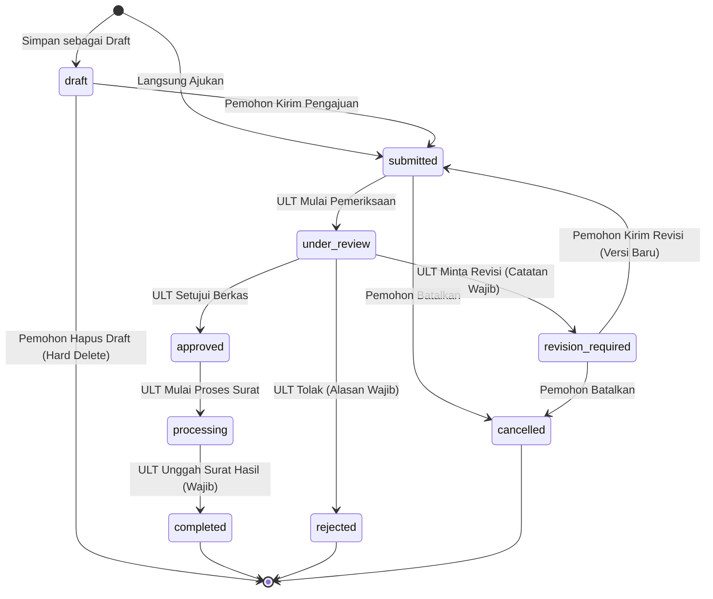

# PRODUCT REQUIREMENTS DOCUMENT (PRD v2.0)
## SISTEM PENGAJUAN SURAT ADMINISTRASI
**Web-based Administrative Letter Management System**

| Informasi Dokumen | Keterangan |
| :--- | :--- |
| **Versi Dokumen** | 2.0 – Implementation, UI/UX & Free Deployment Ready |
| **Status** | Acuan Resmi Pengembangan & Generasi Kode/UI oleh Antigravity |
| **Platform** | Web Application (Responsive Desktop, Tablet, Mobile) |
| **Target Pengguna** | Himpunan/Mahasiswa, ULT (Unit Layanan Terpadu), Superadmin (UPATIK) |
| **Frontend & Backend** | Next.js (App Router, TypeScript, Server Actions & Route Handlers) |
| **Database & Auth** | PostgreSQL & Supabase Auth (`@supabase/ssr`, Row Level Security) |
| **Penyimpanan Dokumen** | Supabase Storage (Private Bucket + Direct Signed Upload/Download URL) |
| **Target Hosting** | **Free Tier Deployment:** Vercel Hobby + Supabase Free Tier |

> **PETUNJUK PEMBACAAN UNTUK ANTIGRAVITY (AGENT DIRECTIVES):**
> Dokumen ini dirancang sebagai *Single Source of Truth* untuk membangun aplikasi secara penuh (End-to-End). Saat menghasilkan kode maupun antarmuka:
> 1. Patuhi secara ketat **Bagian 9 (Skema Database & RLS)**, **Bagian 5 (State Machine Transisi Status)**, dan **Bagian 10 (Spesifikasi UI/UX Anti-Slop AI)**.
> 2. **Dilarang** menggunakan pola UI generik AI (lihat daftar larangan di §10.4). Gunakan sistem token warna berbasis latar `#FFFFFF` dan palet `#091540`, `#1B2CC1`, `#7692FF`, `#ABD2FA`.
> 3. **Wajib** mengimplementasikan upload file langsung dari browser ke Supabase Storage (*Direct Signed Upload*) agar tidak menabrak batas payload 4,5 MB di Vercel Free Tier (lihat §11).
> 4. Jangan membuat placeholder `// TODO`, data dummy "John Doe", atau fungsi terpotong.

---

## 1. Pendahuluan

### 1.1 Latar Belakang
Dalam lingkungan perguruan tinggi, kegiatan administrasi surat-menyurat merupakan kebutuhan vital bagi organisasi mahasiswa, khususnya himpunan mahasiswa (surat peminjaman ruangan, permohonan izin kegiatan, surat pengantar, peminjaman inventaris, dan kebutuhan administratif lainnya).

Proses konvensional saat ini menimbulkan kendala serius: kesulitan pengajuan ke Tata Usaha (TU) / Unit Layanan Terpadu (ULT), risiko draft surat terselip atau hilang akibat tumpukan dokumen fisik dari berbagai himpunan, tidak adanya pencatatan terpusat, serta minimnya transparansi status surat. Sistem informasi berbasis web ini dibangun untuk mendigitalisasi dan mengintegrasikan pengajuan, verifikasi, pemrosesan, hingga pengarsipan surat dalam satu platform terpusat.

### 1.2 Rumusan Masalah
1. Himpunan mahasiswa kesulitan mengajukan surat administrasi secara efisien ke pihak TU/ULT.
2. Dokumen/draft surat berisiko hilang atau terselip akibat volume pengajuan fisik yang tinggi.
3. Belum tersedia sistem pencatatan, pelacakan status, dan penyimpanan versi dokumen yang terpusat.
4. Himpunan kesulitan memantau perkembangan pengajuan tanpa datang langsung ke loket ULT.
5. Pihak ULT membutuhkan alur kerja pengelolaan, pembagian tugas petugas, dan verifikasi yang terstruktur.

### 1.3 Tujuan Produk
1. Memfasilitasi pengajuan surat administrasi oleh himpunan secara online dan terstandar.
2. Meniadakan risiko kehilangan dokumen melalui penyimpanan digital terenkripsi akses dan pencatatan versi (*versioning*).
3. Menyediakan pelacakan status secara real-time beserta *timeline* kronologis.
4. Membantu ULT memeriksa, meminta revisi, menyetujui, memproses, dan mengunggah surat hasil akhir.
5. Memudahkan UPATIK (Superadmin) mengelola akun, organisasi/himpunan, katalog jenis surat, konfigurasi sistem, dan audit log.

### 1.4 Target Pengguna
| Aktor | Role Key (`roles.name`) | Deskripsi |
| :--- | :--- | :--- |
| **Himpunan / Mahasiswa** | `mahasiswa` | Pengurus/perwakilan organisasi mahasiswa yang membuat pengajuan surat, mengunggah draft/revisi, dan mengunduh surat hasil. |
| **Petugas ULT** | `ult` | Staf Unit Layanan Terpadu yang menerima antrean, mengambil/ditugaskan memeriksa berkas, meminta revisi, menyetujui/menolak, memproses surat, dan mengunggah hasil akhir. |
| **Superadmin (UPATIK)** | `superadmin` | Pengelola platform tertinggi untuk manajemen akun, organisasi, katalog jenis surat, konfigurasi sistem, dan pemantauan audit log. |

---

## 2. Ruang Lingkup Produk & Prioritas MVP

### 2.1 Fitur dalam Cakupan (In-Scope) — Resolusi Prioritas
Seluruh alur utama hingga surat berstatus **Selesai** dan dapat diunduh masuk ke dalam **MVP (P0)** agar produk langsung dapat digunakan secara utuh sejak rilis pertama.

| Kode | Fitur | Deskripsi | Prioritas | Target |
| :--- | :--- | :--- | :--- | :--- |
| F-01 | **Autentikasi & Akun** | Login, logout, lupa/reset password, ganti password wajib saat login pertama dari undangan admin. | **P0** | MVP |
| F-02 | **Manajemen Pengguna & Organisasi** | Superadmin mengelola daftar himpunan (`organizations`), membuat/mengundang akun, assign role & organisasi, dan menonaktifkan akun (`is_active`). | **P0** | MVP |
| F-03 | **Dashboard Berbasis Role** | Ringkasan metrik dan daftar tugas/pengajuan relevan sesuai role (`mahasiswa`, `ult`, `superadmin`). | **P0** | MVP |
| F-04 | **Katalog Jenis Surat** | Daftar jenis surat aktif beserta persyaratan dokumen & field form dinamis/terstruktur (dengan *seed data* awal + CRUD Superadmin). | **P0** | MVP |
| F-05 | **Pengajuan & Draft Surat** | Pemohon membuat pengajuan baru, menyimpan sebagai `Draft`, atau langsung mengirim (`Diajukan`). | **P0** | MVP |
| F-06 | **Upload Multi-Dokumen & Versioning** | Upload draft surat dan lampiran pendukung langsung ke Private Supabase Storage; revisi membuat versi baru tanpa menimpa file lama. | **P0** | MVP |
| F-07 | **Antrean & Penugasan ULT** | ULT melihat semua pengajuan masuk, melakukan pencarian/filter, dan mengklaim/menugaskan PIC petugas (`assigned_to`). | **P0** | MVP |
| F-08 | **Verifikasi, Revisi & Pemrosesan** | ULT memverifikasi, meminta revisi (catatan wajib), menolak (alasan wajib), menyetujui, memproses, dan mengunggah dokumen hasil akhir. | **P0** | MVP |
| F-09 | **Pelacakan Status & Timeline** | Pemohon & ULT melihat histori lengkap perubahan status, catatan, pelaku aksi, dan stempel waktu. | **P0** | MVP |
| F-10 | **Unduh Dokumen Aman** | Unduh draft, lampiran, dan surat hasil menggunakan Signed URL berumur pendek (60 detik). | **P0** | MVP |
| F-11 | **Notifikasi In-App** | Notifikasi di dalam aplikasi (lonceng header + daftar notifikasi) ketika status pengajuan berubah atau ada penugasan baru. | **P1** | Rilis 1.1 / MVP+ |
| F-12 | **Audit Log Aktivitas** | Pencatatan otomatis aksi kritis (login gagal/sukses, perubahan role/status, penonaktifan akun, CRUD master data) untuk UPATIK. | **P1** | Rilis 1.1 / MVP+ |
| F-13 | **Ekspor Laporan & Statistik** | Rekapitulasi volume pengajuan per himpunan/jenis surat dan SLA waktu pemrosesan (CSV/PDF). | **P2** | Pengembangan Lanjutan |

> **Catatan Implementasi:** Meski F-11 dan F-12 bertanda P1, skema database (`notifications` dan `audit_logs`) **harus dibuat sejak P0** agar tidak memerlukan migrasi ulang yang merusak alur data.

### 2.2 Fitur di Luar Cakupan (Out-of-Scope)
- Integrasi langsung (API/SSO) dengan Sistem Informasi Akademik (SIAKAD) universitas.
- Tanda tangan elektronik tersertifikasi (BSrE / Privy / Peruri).
- Pengiriman surat fisik melalui jasa ekspedisi/pos.
- Integrasi dengan aplikasi persuratan internal universitas lain (e-Office eksisting).
- Aplikasi mobile native (Android/iOS).
- Integrasi WhatsApp Business API otomatis.

---

## 3. Keputusan Asumsi & Aturan Bisnis Terkunci

Bagian ini menutup ambiguitas dari Bagian 12 PRD v1.0 sehingga tim pengembang/AI tidak perlu menebak aturan bisnis:

| No | Pertanyaan Kunci | Keputusan Final untuk Implementasi | Konfigurabilitas |
| :--- | :--- | :--- | :--- |
| 1 | **Cara pendaftaran akun mahasiswa** | **Admin-Managed (Closed System).** Mahasiswa tidak bisa daftar bebas. Superadmin membuat akun atau mengirim undangan email (`inviteUserByEmail`) yang terikat ke `organization_id` tertentu. | Tetap (Keamanan Kampus) |
| 2 | **Kepemilikan akun himpunan** | **Multi-pengurus per himpunan.** Satu himpunan dapat memiliki >1 akun pengurus. Seluruh pengurus dalam 1 `organization_id` dapat melihat daftar & detail pengajuan milik organisasinya. | Tetap |
| 3 | **Visibilitas & penugasan ULT** | Semua petugas ULT dapat melihat seluruh antrean pengajuan masuk. Tersedia tombol **"Ambil Tugas"** (`assigned_to = current_user`) atau penugasan oleh sesama ULT untuk mencegah kerja ganda. | Tetap |
| 4 | **Cakupan tugas ULT** | ULT melakukan **verifikasi berkas** DAN **pemrosesan/upload surat hasil** (termasuk pengisian `official_letter_number` jika surat sudah ditandatangani pimpinan secara offline/internal). | Tetap |
| 5 | **Multi-dokumen & Revisi** | Pemohon dapat mengunggah lebih dari 1 dokumen (1 Draft Utama + N Dokumen Pendukung). Saat revisi, sistem **menyimpan versi baru (`version + 1`)** dan menandai versi sebelumnya `is_current = false`. | Tetap |
| 6 | **Penomoran Pengajuan vs Surat Resmi** | **Nomor Pengajuan (`submission_number`):** Dibuat otomatis oleh sistem secara atomik saat status berubah dari `draft` ke `submitted` (atau saat langsung diajukan), format `ADM-{TAHUN}-{5_DIGIT_URUT}` (contoh: `ADM-2026-00001`), reset urut setiap tahun. **Nomor Surat Resmi (`official_letter_number`):** Diisi manual oleh petugas ULT sesuai buku agenda/aturan tata naskah universitas. | Prefix format dapat diatur di `system_settings` |
| 7 | **Kanal Notifikasi** | **Notifikasi In-App** untuk perubahan status; **Email Transaksional** khusus untuk alur autentikasi (undangan akun & reset password) melalui Custom SMTP (Resend Free Tier) agar tidak terkena limit email bawaan Supabase Free. | Ya |
| 8 | **Role & Hak Akses** | **3 Role Tetap** (`mahasiswa`, `ult`, `superadmin`). Halaman manajemen role di Superadmin menampilkan daftar role & matriks hak akses (*read-only matrix*) serta penugasan role ke pengguna (bukan builder permission dinamis). | Tetap |

---

## 4. Aktor dan Matriks Hak Akses (RBAC)

### 4.1 Matriks Izin Aksi per Resource

| Resource / Aksi | `mahasiswa` (Himpunan) | `ult` (Petugas) | `superadmin` (UPATIK) |
| :--- | :---: | :---: | :---: |
| **Dashboard** | Ringkasan milik organisasinya | Ringkasan antrean & tugasnya | Statistik keseluruhan sistem |
| **Jenis Surat (`letter_types`)** | Lihat yang aktif (`is_active = true`) | Lihat semua | CRUD penuh + kelola syarat |
| **Organisasi (`organizations`)** | Lihat profil organisasinya | Lihat semua | CRUD penuh |
| **Pengajuan (`submissions`) - Lihat** | Hanya milik `organization_id`-nya | Semua (kecuali `draft` milik pemohon) | Semua (read-only pengawasan) |
| **Pengajuan - Buat & Edit Draft** | Ya (selama status `draft`) | Tidak | Tidak |
| **Pengajuan - Hapus** | Ya (hanya saat status `draft`) | Tidak | Tidak |
| **Pengajuan - Batalkan** | Ya (hanya saat status `submitted`) | Tidak | Tidak |
| **Pengajuan - Revisi** | Ya (hanya saat status `revision_required`) | Tidak | Tidak |
| **Pengajuan - Verifikasi/Proses/Selesai** | Tidak | Ya (ubah status, catatan, nomor surat) | Tidak (kecuali override darurat jika perlu) |
| **Dokumen (`submission_documents`)** | Upload draft/pendukung/revisi; Unduh semua file organisasinya (termasuk surat hasil) | Unduh draft/pendukung; Upload surat hasil (`result_letter`) | Lihat metadata; Unduh untuk audit |
| **Pengguna (`users`)** | Edit profil dasar sendiri (nama, no. HP) | Edit profil dasar sendiri | CRUD akun, assign role/organisasi, aktif/nonaktifkan |
| **Notifikasi (`notifications`)** | Lihat & tandai dibaca milik sendiri | Lihat & tandai dibaca milik sendiri | Lihat & tandai dibaca milik sendiri |
| **Audit Log (`audit_logs`)** | Tidak | Tidak | Lihat & filter seluruh log |
| **Pengaturan Sistem (`system_settings`)** | Tidak | Tidak | Lihat & ubah konfigurasi global |

---

## 5. Alur Bisnis & State Machine Status Pengajuan

### 5.1 Diagram State Machine



### 5.2 Tabel Matriks Transisi Status (Aturan Eksekusi Backend)
Backend (Server Action / Route Handler) **wajib memvalidasi transisi** terhadap tabel ini. Transisi di luar tabel harus ditolak dengan HTTP `400/422` (`INVALID_STATUS_TRANSITION`).

| Status Asal | Status Tujuan | Label UI (ID) | Aktor Sah | Syarat / Validasi Wajib | Efek Samping Sistem |
| :--- | :--- | :--- | :--- | :--- | :--- |
| *(Baru)* | `draft` | Draft | `mahasiswa` | Pilih `letter_type_id` & isi judul/perihal | Simpan record tanpa `submission_number` (atau prefix `DRAFT-*`). |
| `draft` / *(Baru)* | `submitted` | Diajukan | `mahasiswa` | Semua field wajib & dokumen wajib per `letter_type` terpenuhi | Generate `submission_number` (`ADM-YYYY-NNNNN`), set `submitted_at = now()`, tulis history, kirim notif ke semua ULT aktif. |
| `draft` | *(Deleted)* | — | `mahasiswa` | Status harus `draft` & milik organisasinya | Hapus file di Storage + hapus record DB. |
| `submitted` / `revision_required` | `cancelled` | Dibatalkan | `mahasiswa` | Belum berstatus `under_review` ke atas | Set `status = 'cancelled'`, tulis history dengan alasan opsional, notif ke PIC ULT (jika sudah ada). |
| `submitted` | `under_review` | Sedang Diverifikasi | `ult` | Dipicu saat ULT klik **"Mulai Verifikasi"** | Set `assigned_to = ult_user.id` (jika kosong), tulis history, notif ke pemohon. |
| `under_review` | `revision_required` | Perlu Revisi | `ult` | `notes` minimal 10 karakter wajib diisi | Tulis history + `notes`, notif ke seluruh pengurus `organization_id` terkait. |
| `revision_required` | `submitted` | Diajukan | `mahasiswa` | Wajib mengunggah minimal 1 file versi baru atau memperbarui data | Increment `version` dokumen baru (`is_current = true`), versi lama `is_current = false`, tulis history, notif ke PIC ULT. |
| `under_review` | `approved` | Disetujui | `ult` | Semua persyaratan valid | Tulis history, notif ke pemohon. |
| `under_review` | `rejected` | Ditolak | `ult` | `notes` (alasan penolakan) minimal 10 karakter wajib diisi | Status final; tulis history + `notes`, notif ke pemohon. |
| `approved` | `processing` | Diproses | `ult` | Dipicu saat surat masuk tahap cetak/penomoran/TTD pimpinan offline | Opsional isi estimasi selesai; tulis history, notif ke pemohon. |
| `processing` | `completed` | Selesai | `ult` | **Wajib** ada minimal 1 file bertipe `result_letter` & `official_letter_number` (jika berlaku) | Set `completed_at = now()`, tulis history, notif ke pemohon bahwa surat siap diunduh. |

---

## 6. Kebutuhan Fungsional & Acceptance Criteria

| Kode | Kebutuhan | Aktor | Kriteria Penerimaan (Acceptance Criteria) |
| :--- | :--- | :--- | :--- |
| **KF-01** | Login, Logout & Reset Password | Semua | Login email+password melalui Supabase Auth. Akun dengan `is_active = false` ditolak loginnya dengan pesan jelas. Tersedia alur lupa password via email. |
| **KF-02** | Otorisasi Role & Organisasi | Sistem | Middleware Next.js mengarahkan user sesuai role (`/mahasiswa`, `/ult`, `/admin`); RLS PostgreSQL memblokir akses silang antar organisasi di level DB. |
| **KF-03** | Dashboard Kontekstual | Semua | Menampilkan metrik spesifik role (Mahasiswa: total/proses/revisi/selesai; ULT: antrean baru/tugas saya/sedang diproses; Admin: statistik total & log terbaru). |
| **KF-04** | Katalog Jenis Surat | Mahasiswa | Menampilkan daftar jenis surat aktif lengkap dengan deskripsi, estimasi waktu proses, daftar dokumen wajib, dan tombol unduh template surat (jika ada). |
| **KF-05** | Buat & Simpan Draft Pengajuan | Mahasiswa | Form menampilkan field standar (perihal, tujuan surat, tanggal kegiatan/kebutuhan, ringkasan) + field khusus jenis surat. Bisa disimpan sebagai `draft` kapan saja. |
| **KF-06** | Upload Multi-Dokumen & Revisi Berversi | Mahasiswa | Direct upload ke Supabase Storage (PDF/DOCX/JPG/PNG, maks 5 MB/file, maks 5 file). Saat revisi, dokumen lama tetap tersimpan dan terlihat di tab riwayat versi. |
| **KF-07** | Nomor Pengajuan Unik Atomik | Sistem | Dihasilkan oleh fungsi PostgreSQL (`generate_submission_number()`) sehingga bebas *race condition* jika dua himpunan mengirim di detik yang sama. |
| **KF-08** | Penyimpanan Data Konsisten | Sistem | Pembaruan status dan penulisan `submission_histories` dieksekusi dalam transaksi/RPC atomik agar tidak pernah ada perubahan status tanpa jejak history. |
| **KF-09** | Antrean Pengajuan ULT | ULT | Tabel/daftar seluruh pengajuan non-draft dengan badge status, pengusul (himpunan), jenis surat, tanggal masuk, dan PIC petugas. |
| **KF-10** | Detail & Pratinjau Dokumen | ULT | ULT dapat melihat metadata pengajuan, membuka pratinjau PDF langsung di browser (via Signed URL), atau mengunduh file asli. |
| **KF-11** | Penugasan Petugas ULT | ULT | ULT dapat mengklik "Ambil Tugas" atau memindahkan penugasan (`assigned_to`) ke petugas ULT lain. |
| **KF-12** | Persetujuan & Pemrosesan | ULT | ULT dapat mengubah status ke `under_review` → `approved` → `processing` secara berurutan dengan catatan opsional. |
| **KF-13** | Permintaan Revisi & Penolakan | ULT | Form revisi/tolak memblokir submit jika kolom catatan kosong (<10 karakter). |
| **KF-14** | Perbaikan Pengajuan oleh Pemohon | Mahasiswa | Tombol "Kirim Revisi" hanya aktif jika status `revision_required` dan pemohon telah mengunggah revisi atau memperbarui isian. |
| **KF-15** | Timeline Aktivitas Kronologis | Semua | Menampilkan urutan waktu aksi dari paling baru/lama beserta nama aktor, role, perubahan status, dan catatan. |
| **KF-16** | Pelacakan Status Publik/Internal | Mahasiswa | Pemohon dapat melacak status terkini dari daftar riwayat maupun pencarian cepat berdasarkan `submission_number`. |
| **KF-17** | Notifikasi Perubahan Status | Sistem | Setiap transisi status menyisipkan record ke `notifications` untuk penerima relevan dan memperbarui indikator belum dibaca. |
| **KF-18** | Upload Surat Hasil Akhir | ULT | Pada status `processing`, ULT mengunggah file hasil resmi (PDF, maks 5 MB) dan mengisi nomor surat resmi untuk menyelesaikan pengajuan (`completed`). |
| **KF-19** | Unduh Surat Selesai | Mahasiswa | Pemohon menerima tombol CTA utama "Unduh Surat Resmi" pada detail pengajuan berstatus `completed`. |
| **KF-20** | Manajemen Akun & Organisasi | Superadmin | Superadmin dapat membuat/mengundang pengguna, menetapkan `role_id` dan `organization_id`, mengedit data, dan menonaktifkan akun (soft-disable). |
| **KF-21** | Manajemen Jenis Surat | Superadmin | Superadmin dapat menambah/mengubah jenis surat, mengatur daftar dokumen wajib, field tambahan, dan menonaktifkan jenis surat tanpa menghapus data historis. |
| **KF-22** | Audit Log Sistem | Superadmin | Mencatat event autentikasi dan mutasi data penting (`user_id`, `action`, `entity_type`, `entity_id`, `metadata JSONB`, `created_at`). |
| **KF-23** | Pencarian & Filter Terpadu | Semua | Filter berdasarkan kata kunci (nomor pengajuan / perihal), status, jenis surat, organisasi (ULT/Admin), dan rentang tanggal. |
| **KF-24** | Pembatalan & Hapus Draft | Mahasiswa | Pemohon bisa menghapus `draft` atau membatalkan pengajuan berstatus `submitted` / `revision_required`. |

---

## 7. Kebutuhan Non-Fungsional (KNF) Terukur

| Kode | Aspek | Target Terukur & Kriteria Uji |
| :--- | :--- | :--- |
| **KNF-01** | **Keamanan Autentikasi & Otorisasi** | 100% akses data dilindungi RLS PostgreSQL; `SUPABASE_SERVICE_ROLE_KEY` tidak pernah terekspos ke client bundle; password minimal 8 karakter (kombinasi huruf & angka). |
| **KNF-02** | **Keamanan Dokumen** | Bucket Supabase Storage bersifat **Private**. Akses baca/unduh wajib via Signed URL dengan masa berlaku maksimal **120 detik**. |
| **KNF-03** | **Kinerja (Performance)** | Waktu respons query API/Server Action p95 < **1.500 ms**; First Contentful Paint (FCP) < **1,8 detik**; Largest Contentful Paint (LCP) < **2,5 detik**. |
| **KNF-04** | **Ketersediaan (Availability)** | Aplikasi tersedia 24/7 melalui Vercel & Supabase dengan mekanisme *keep-alive* otomatis agar Supabase Free Tier tidak mengalami auto-pause. |
| **KNF-05** | **Responsivitas** | Berfungsi penuh tanpa horizontal scroll pada viewport Mobile (`375px`), Tablet (`768px`), dan Desktop (`1280px–1920px`). |
| **KNF-06** | **Aksesibilitas (a11y)** | Rasio kontras teks minimum memenuhi **WCAG 2.1 AA (≥ 4,5:1)**; seluruh aksi utama dapat dinavigasi menggunakan keyboard (`Tab`, `Enter`, `Esc`). |
| **KNF-07** | **Integritas & Konsistensi Data** | Transisi status dan pencatatan riwayat dijalankan atomik; penghapusan master data (`letter_types`, `organizations`, `users`) menggunakan `is_active = false` (soft disable) jika sudah memiliki relasi pengajuan. |
| **KNF-08** | **Efisiensi Free Tier** | Ukuran upload per file dibatasi **maks 5 MB**; maksimal **5 file** per pengajuan; *client-side validation* tipe & ukuran sebelum meminta Signed Upload URL. |

---

## 8. Arsitektur Sistem & Kebijakan File

### 8.1 Alur Upload & Download File (Wajib untuk Vercel Free Tier)
Karena Vercel Hobby membatasi ukuran *request body* Serverless Function sebesar **4,5 MB**, aplikasi **dilarang** mengirim file melalui Next.js API Route atau Server Action.

1. **Alur Upload (Direct-to-Storage):**
   - Client memvalidasi tipe file (`.pdf`, `.docx`, `.jpg`, `.jpeg`, `.png`) dan ukuran (`≤ 5 MB`).
   - Client memanggil Server Action `requestUploadUrl({ submissionId, fileName, fileSize, mimeType, documentType })`.
   - Server Action memverifikasi autentikasi, otorisasi kepemilikan, kuota file, lalu memanggil `supabaseAdmin.storage.from('submission-files').createSignedUploadUrl(path)`.
   - Client mengunggah file biner **langsung ke Supabase Storage** menggunakan Signed Upload URL tersebut (mendukung progress bar upload).
   - Setelah upload ke Storage sukses, client memanggil Server Action `confirmDocumentUpload(...)` untuk mencatat metadata & nomor versi ke tabel `submission_documents`.
2. **Alur Unduh / Pratinjau:**
   - Client meminta Signed Download URL melalui Server Action `getDocumentSignedUrl(documentId)`.
   - Server memverifikasi hak akses user atas `submission_id` terkait, lalu mengembalikan Signed URL berdurasi 60–120 detik.

---

## 9. Rancangan Database Lengkap (PostgreSQL / Supabase)

### 9.1 Skema DDL Referensi
Gunakan skema ini sebagai dasar file migrasi SQL (`supabase/migrations/0001_initial_schema.sql`):

```sql
-- Enum Types
CREATE TYPE user_role AS ENUM ('mahasiswa', 'ult', 'superadmin');
CREATE TYPE submission_status AS ENUM (
  'draft',
  'submitted',
  'under_review',
  'revision_required',
  'approved',
  'processing',
  'completed',
  'rejected',
  'cancelled'
);
CREATE TYPE document_category AS ENUM ('draft_letter', 'supporting_doc', 'result_letter');

-- 1. Organizations (Himpunan / UKM / Ormawa)
CREATE TABLE organizations (
  id UUID PRIMARY KEY DEFAULT gen_random_uuid(),
  code VARCHAR(30) UNIQUE NOT NULL,          -- misal: 'HMIF', 'HMTI', 'BEM-FT'
  name VARCHAR(150) NOT NULL,
  faculty VARCHAR(150),
  description TEXT,
  is_active BOOLEAN NOT NULL DEFAULT true,
  created_at TIMESTAMPTZ NOT NULL DEFAULT now(),
  updated_at TIMESTAMPTZ NOT NULL DEFAULT now()
);

-- 2. Users Profile (Terpisah dari auth.users Supabase)
CREATE TABLE users (
  id UUID PRIMARY KEY REFERENCES auth.users(id) ON DELETE CASCADE,
  name VARCHAR(150) NOT NULL,
  email VARCHAR(255) UNIQUE NOT NULL,
  nim_nip VARCHAR(40),
  phone VARCHAR(30),
  role user_role NOT NULL DEFAULT 'mahasiswa',
  organization_id UUID REFERENCES organizations(id) ON DELETE SET NULL,
  is_active BOOLEAN NOT NULL DEFAULT true,
  must_change_password BOOLEAN NOT NULL DEFAULT false,
  created_at TIMESTAMPTZ NOT NULL DEFAULT now(),
  updated_at TIMESTAMPTZ NOT NULL DEFAULT now()
);

-- 3. Letter Types (Katalog Jenis Surat)
CREATE TABLE letter_types (
  id UUID PRIMARY KEY DEFAULT gen_random_uuid(),
  code VARCHAR(30) UNIQUE NOT NULL,          -- misal: 'PINJAM-RUANG', 'IZIN-KEGIATAN'
  name VARCHAR(150) NOT NULL,
  description TEXT,
  estimated_days INTEGER NOT NULL DEFAULT 3,
  -- JSONB array: [{"key":"proposal","label":"Proposal Kegiatan","required":true,"accepted_types":["pdf"]}]
  required_documents JSONB NOT NULL DEFAULT '[]'::jsonb,
  -- JSONB array: [{"key":"event_date","label":"Tanggal Kegiatan","type":"date","required":true}]
  custom_fields_schema JSONB NOT NULL DEFAULT '[]'::jsonb,
  template_file_path TEXT,
  is_active BOOLEAN NOT NULL DEFAULT true,
  created_at TIMESTAMPTZ NOT NULL DEFAULT now(),
  updated_at TIMESTAMPTZ NOT NULL DEFAULT now()
);

-- 4. Sequence Counter per Tahun untuk Nomor Pengajuan Atomik
CREATE TABLE submission_counters (
  year INTEGER PRIMARY KEY,
  last_number INTEGER NOT NULL DEFAULT 0
);

-- 5. Submissions (Data Pengajuan Utama)
CREATE TABLE submissions (
  id UUID PRIMARY KEY DEFAULT gen_random_uuid(),
  submission_number VARCHAR(30) UNIQUE,      -- NULL saat draft, terisi 'ADM-2026-00001' saat submitted
  official_letter_number VARCHAR(100),       -- Diisi ULT saat diproses/selesai
  user_id UUID NOT NULL REFERENCES users(id),
  organization_id UUID NOT NULL REFERENCES organizations(id),
  letter_type_id UUID NOT NULL REFERENCES letter_types(id),
  assigned_to UUID REFERENCES users(id) ON DELETE SET NULL,
  title VARCHAR(255) NOT NULL,               -- Perihal / Judul pengajuan
  purpose TEXT NOT NULL,                     -- Tujuan / Keterangan ringkas
  recipient_target VARCHAR(255),             -- Ditujukan kepada (misal: Wakil Dekan II)
  event_date DATE,                           -- Tanggal kegiatan/kebutuhan (jika relevan)
  custom_data JSONB NOT NULL DEFAULT '{}'::jsonb,
  status submission_status NOT NULL DEFAULT 'draft',
  submitted_at TIMESTAMPTZ,
  completed_at TIMESTAMPTZ,
  created_at TIMESTAMPTZ NOT NULL DEFAULT now(),
  updated_at TIMESTAMPTZ NOT NULL DEFAULT now()
);

-- 6. Submission Documents (Dengan Versioning)
CREATE TABLE submission_documents (
  id UUID PRIMARY KEY DEFAULT gen_random_uuid(),
  submission_id UUID NOT NULL REFERENCES submissions(id) ON DELETE CASCADE,
  document_key VARCHAR(80) NOT NULL DEFAULT 'draft_utama', -- Cocokkan dengan required_documents key
  category document_category NOT NULL,
  file_name VARCHAR(255) NOT NULL,
  file_path TEXT NOT NULL,
  file_size_bytes INTEGER NOT NULL CHECK (file_size_bytes > 0 AND file_size_bytes <= 5242880),
  mime_type VARCHAR(120) NOT NULL,
  version INTEGER NOT NULL DEFAULT 1,
  is_current BOOLEAN NOT NULL DEFAULT true,
  uploaded_by UUID NOT NULL REFERENCES users(id),
  created_at TIMESTAMPTZ NOT NULL DEFAULT now()
);

-- 7. Submission Histories (Timeline Aktivitas & Status)
CREATE TABLE submission_histories (
  id UUID PRIMARY KEY DEFAULT gen_random_uuid(),
  submission_id UUID NOT NULL REFERENCES submissions(id) ON DELETE CASCADE,
  from_status submission_status,
  to_status submission_status NOT NULL,
  notes TEXT,
  updated_by UUID NOT NULL REFERENCES users(id),
  created_at TIMESTAMPTZ NOT NULL DEFAULT now()
);

-- 8. Notifications
CREATE TABLE notifications (
  id UUID PRIMARY KEY DEFAULT gen_random_uuid(),
  user_id UUID NOT NULL REFERENCES users(id) ON DELETE CASCADE,
  submission_id UUID REFERENCES submissions(id) ON DELETE CASCADE,
  title VARCHAR(180) NOT NULL,
  message TEXT NOT NULL,
  is_read BOOLEAN NOT NULL DEFAULT false,
  created_at TIMESTAMPTZ NOT NULL DEFAULT now()
);

-- 9. Audit Logs
CREATE TABLE audit_logs (
  id UUID PRIMARY KEY DEFAULT gen_random_uuid(),
  user_id UUID REFERENCES users(id) ON DELETE SET NULL,
  action VARCHAR(80) NOT NULL,               -- misal: 'SUBMISSION_STATUS_CHANGED', 'USER_CREATED'
  entity_type VARCHAR(60) NOT NULL,
  entity_id UUID,
  metadata JSONB NOT NULL DEFAULT '{}'::jsonb,
  ip_address VARCHAR(45),
  created_at TIMESTAMPTZ NOT NULL DEFAULT now()
);

-- 10. System Settings (Konfigurasi Ringan)
CREATE TABLE system_settings (
  key VARCHAR(80) PRIMARY KEY,
  value JSONB NOT NULL,
  updated_by UUID REFERENCES users(id),
  updated_at TIMESTAMPTZ NOT NULL DEFAULT now()
);

-- Index Penting untuk Performa Query
CREATE INDEX idx_submissions_org_status ON submissions(organization_id, status);
CREATE INDEX idx_submissions_status_created ON submissions(status, created_at DESC);
CREATE INDEX idx_submissions_assigned_to ON submissions(assigned_to);
CREATE INDEX idx_submission_docs_sub_current ON submission_documents(submission_id, is_current);
CREATE INDEX idx_submission_histories_sub ON submission_histories(submission_id, created_at ASC);
CREATE INDEX idx_notifications_user_unread ON notifications(user_id, is_read, created_at DESC);
```

### 9.2 Seed Data Awal Katalog Jenis Surat
Agar MVP langsung dapat dipakai tanpa menunggu input manual penuh, sediakan *seed* awal:
1. `PINJAM-RUANG` — **Surat Peminjaman Ruangan / Fasilitas** (Dokumen wajib: Draft Surat, Rundown/Jadwal Pemakaian).
2. `IZIN-KEGIATAN` — **Surat Permohonan Izin Kegiatan** (Dokumen wajib: Draft Surat, Proposal Kegiatan, Susunan Kepanitiaan).
3. `SURAT-PENGANTAR` — **Surat Pengantar / Rekomendasi Organisasi** (Dokumen wajib: Draft Surat, Dokumen Pendukung/Undangan).
4. `PINJAM-INVENTARIS` — **Surat Peminjaman Inventaris Kampus** (Dokumen wajib: Draft Surat, Daftar Alat).

---

## 10. Spesifikasi UI/UX Anti-Slop AI untuk Antigravity (`DESIGN_SYSTEM_AND_UX_SPEC`)

Bagian ini adalah **instruksi wajib** bagi Antigravity ketika menghasilkan kode frontend, styling Tailwind, komponen `shadcn/ui`, dan tata letak halaman.

### 10.1 Arah Estetika & Positioning Visual
- **Nama Estetika:** *Institutional Swiss Editorial & Crisp Civic Workspace*
- **Karakter:** Bersih, presisi tinggi, terasa seperti instrumen birokrasi modern yang cepat, terpercaya, dan tidak melelahkan mata.
- **Prinsip Permukaan:** Latar belakang utama adalah **Putih Murni (`#FFFFFF`)** dengan pemisahan struktur menggunakan garis tipis (`1px hairline`), ruang kosong (*whitespace*) yang disiplin, dan warna tinta gelap biru malam (`#091540`) sebagai pengganti hitam pekat (`#000000`).
- **Differentiation Anchor:** Antarmuka dikenali bukan dari kartu berwarna-warni atau gradien mencolok, melainkan dari **ketajaman tipografi monospace pada nomor surat (`ADM-2026-00001`)**, **garis pemisah presisi dengan aksen biru kobalt (`#1B2CC1`)**, dan **timeline vertikal kronologis** yang menyerupai catatan arsip modern.

### 10.2 Sistem Warna Wajib & Aturan Kontras (WCAG Verified)

> **PALET REFERENSI TERKUNCI:** `#FFFFFF` (Main Background), `#091540`, `#1B2CC1`, `#7692FF`, `#ABD2FA`.

#### A. Peran Setiap Token Warna

| Token CSS | Hex | Peran Fungsional | Aturan Penggunaan Ketat |
| :--- | :--- | :--- | :--- |
| `--bg-canvas` | **`#FFFFFF`** | Latar belakang utama seluruh aplikasi, kartu konten, tabel, dan modal | **Wajib dominan (>75% area layar).** |
| `--bg-subtle` | `#F6F9FE` | Latar sidebar/rail, header tabel, zebra-hover ringan | Turunan tint ultra-halus dari `#ABD2FA` di atas `#FFFFFF`. |
| `--ink-primary` | **`#091540`** | Teks utama, judul halaman, heading tabel, ikon aktif, teks di atas `#ABD2FA` | Pengganti `#000000`. Kontras **17,5:1** di atas `#FFFFFF` (AAA). |
| `--ink-muted` | `#475577` | Teks sekunder, label field, metadata, timestamp | Turunan netral-dingin dari `#091540` agar kontras tetap ≥ **7:1** di atas putih. |
| `--brand-primary` | **`#1B2CC1`** | Primary CTA Button (`Ajukan Surat`, `Setujui`, `Simpan`), active nav indicator, text link, focus ring | Kontras **9,7:1** dengan `#FFFFFF`. Teks di dalam tombol `#1B2CC1` wajib `#FFFFFF`. |
| `--brand-primary-hover` | `#142196` | Hover state tombol primer `#1B2CC1` | Lebih gelap untuk feedback taktil yang tegas. |
| `--brand-accent` | **`#7692FF`** | Border fokus sekunder, highlight chart/progress bar, border hover ringan, aksen ilustrasi garis | **LARANGAN WCAG:** Kontras dengan putih hanya ~2,97:1. **DILARANG** dipakai untuk teks kecil di atas putih, dan **DILARANG** menaruh teks putih di atas `#7692FF`. |
| `--brand-wash` | **`#ABD2FA`** | Latar pill navigasi aktif, background info banner, selected table row (`#ABD2FA/25`), badge netral/diajukan | Selalu pasangkan dengan teks **`#091540`** (kontras **11,4:1**, AAA). |
| `--border-hairline` | `#DCE6F7` | Garis pemisah 1px antar baris tabel, sidebar, dan panel | Halus namun tetap terdefinisi jelas di atas `#FFFFFF`. |

#### B. Konfigurasi CSS Variables Siap Pakai (`globals.css`)
Antigravity harus mendefinisikan token ini di `src/app/globals.css` dan memetakannya ke variabel `shadcn/ui`:

```css
:root {
  --background: #ffffff;
  --foreground: #091540;

  --surface-subtle: #f6f9fe;
  --surface-wash: #abd2fa;

  --primary: #1b2cc1;
  --primary-foreground: #ffffff;
  --primary-hover: #142196;

  --accent-periwinkle: #7692ff;
  --border-hairline: #dce6f7;
  --muted-foreground: #475577;

  --radius-control: 0.5rem;   /* 8px untuk button, input, badge */
  --radius-panel: 0.75rem;    /* 12px untuk container/drawer/dialog */
}
```

#### C. Palet Status Pengajuan (Terkalibrasi, Non-Neon)
Gunakan pill status dengan `border` tipis + latar pastel bersih + teks kontras tinggi:

| Status | Latar (`bg`) | Teks (`text`) | Border (`border`) |
| :--- | :--- | :--- | :--- |
| `draft` | `#F1F5F9` | `#334155` | `#CBD5E1` |
| `submitted` (*Diajukan*) | `#E8F2FE` (tint `#ABD2FA`) | `#091540` | `#ABD2FA` |
| `under_review` (*Diverifikasi*) | `#EEF2FF` | `#1B2CC1` | `#7692FF` |
| `revision_required` (*Perlu Revisi*) | `#FEF3C7` | `#92400E` | `#F59E0B` |
| `approved` (*Disetujui*) | `#E0F2FE` | `#075985` | `#7DD3FC` |
| `processing` (*Diproses*) | `#E0E7FF` | `#1E3A8A` | `#7692FF` |
| `completed` (*Selesai*) | `#DCFCE7` | `#166534` | `#86EFAC` |
| `rejected` (*Ditolak*) | `#FEE2E2` | `#991B1B` | `#FCA5A5` |
| `cancelled` (*Dibatalkan*) | `#F1F5F9` | `#64748B` | `#E2E8F0` |

---

### 10.3 Tipografi & Hirarki Data
- **Font Keluarga Utama (UI & Headings):** `Plus Jakarta Sans` (atau `Geist` via `next/font/google`).
  - **DILARANG KERAS:** `Inter`, `Roboto`, `Arial`, atau font *Serif* untuk antarmuka dashboard.
- **Font Monospace (Kode & Angka Presisi):** `JetBrains Mono` (atau `Geist Mono`) dengan `tabular-nums`.
  - **Wajib diterapkan pada:** `submission_number` (`ADM-2026-00001`), `official_letter_number`, angka KPI statistik, ukuran file (`2.4 MB`), dan timestamp pada timeline (`14 Nov 2026, 09:30 WIB`).
- **Skala Tipografi:**
  - Judul Halaman: `text-2xl md:text-3xl font-semibold tracking-tight text-[#091540]` (hindari H1 raksasa yang berteriak di dashboard).
  - Judul Seksi: `text-base font-semibold tracking-tight text-[#091540]`.
  - Label Form: `text-sm font-medium text-[#091540]` (selalu berada **di atas** input dengan jarak `gap-1.5`).
  - Body/Deskripsi: `text-sm text-[#475577] leading-relaxed max-w-[65ch]`.

---

### 10.4 Aturan Anti-Slop AI (Hard Constraints untuk Antigravity)
Setiap komponen atau halaman yang melanggar aturan di bawah ini dianggap **gagal desain**:

1. **ANTI-CARD-OVERUSE:** Dilarang membungkus setiap blok data ke dalam kartu kotak dengan `shadow-md` dan `rounded-2xl` yang seragam. Gunakan pengelompokan berbasis **garis tipis `1px` (`border-[#DCE6F7]`, `divide-y`)**, latar tint halus `#F6F9FE`, dan whitespace. Gunakan elevasi (`shadow`) **hanya** untuk elemen mengambang seperti Modal, Drawer, Dropdown, dan Popover.
2. **NO AI GRADIENT & NO NEON GLOW:** Dilarang keras memakai gradien ungu/biru ala SaaS generik, teks bergradien, atau *outer glow* (`box-shadow: 0 0 20px ...`). Tombol dan header tetap solid, datar, dan tajam.
3. **ANTI-EMOJI POLICY:** **DILARANG** menggunakan emoji (`📄`, `✅`, `🚀`, `⚠️`) di dalam UI, badge, toast, judul, atau kode. Gunakan ikon vektor seragam dari `@phosphor-icons/react` atau `lucide-react` dengan ketebalan garis konsisten (`strokeWidth={1.5}`).
4. **NO DEFAULT SHADCN LOOK:** Komponen `shadcn/ui` wajib dikustomisasi agar menggunakan variabel warna di §10.2B, radius `8px`/`12px`, dan focus ring `ring-2 ring-[#7692FF] ring-offset-2`.
5. **NO 3-COLUMN MARKETING CLICHÉ & NO CENTERED HERO:** Halaman Login dan Dashboard tidak boleh menggunakan tata letak hero simetris di tengah atau 3 kartu fitur identik. Gunakan komposisi **asimetris (split-screen / workspace 2-kolom)** yang berorientasi kerja.
6. **MANDATORY INTERACTION STATES:** Setiap halaman/komponen data wajib memiliki:
   - **Loading State:** *Skeleton loader* yang bentuk dan tingginya presisi mengikuti baris tabel/panel (bukan spinner melingkar generik di tengah layar).
   - **Empty State:** Ilustrasi ikon garis halus (`#7692FF` / `#091540`), kalimat jelas, dan satu tombol aksi primer (misal: *"Belum ada pengajuan surat dari HMIF. Buat pengajuan pertama Anda."*).
   - **Inline Form Error:** Pesan validasi spesifik langsung di bawah field bermasalah (`text-xs text-[#991B1B]`), bukan hanya alert pop-up.
   - **Tactile Feedback:** Tombol menggunakan transisi cepat `transition-transform duration-150 active:scale-[0.98]`.
7. **VIEWPORT & MOBILE SAFETY:**
   - Gunakan `min-h-[100dvh]`, **jangan** gunakan `h-screen`.
   - Grid multi-kolom (`grid-cols-1 lg:grid-cols-[2fr_1fr]`) harus otomatis meluruh menjadi 1 kolom penuh pada viewport `< 768px`, dan tabel data pada mobile berubah menjadi *stacked list row* yang ringkas tanpa scroll horizontal.
8. **BAHASA & DATA REALISTIS:** Gunakan Bahasa Indonesia baku-profesional yang ringkas. Dilarang memakai kata klise AI (*"Revolusioner", "Seamless", "Melesat", "Elevate"*) maupun nama fiktif Barat (*"John Doe", "Acme Corp"*). Gunakan contoh nyata kampus Indonesia (*Himpunan Mahasiswa Teknik Informatika*, *BEM Fakultas Teknik*, *Budi Santoso*, `ADM-2026-00042`).

---

### 10.5 Blueprint Tata Letak per Halaman

#### 1. Halaman Login (`/login`)
- **Layout:** Split-Screen 50/50 Asimetris (`min-h-[100dvh]`). Pada mobile, tampilkan header kompak di atas form.
- **Panel Kiri (Identitas Institusional):** Latar `#091540` dengan aksen garis geometris tipis warna `#1B2CC1` dan `#7692FF` (tanpa foto stok norak atau bola cahaya 3D). Menampilkan nama sistem, keterangan singkat layanan administrasi kampus (ULT & UPATIK), dan informasi kontak bantuan jika belum memiliki akun.
- **Panel Kanan (Form Autentikasi):** Latar murni `#FFFFFF`. Form rata kiri (`max-w-sm`), label di atas input, input Email & Password (dengan toggle lihat password), tautan *Lupa Password?*, dan tombol primer penuh warna `#1B2CC1`.

#### 2. App Shell (Authenticated Layout)
- **Desktop (`lg+`):**
  - **Sidebar Kiri Tetap (`w-64`, latar `#F6F9FE`, border kanan `1px solid #DCE6F7`):** Logo/nama sistem di atas, info organisasi/role pengguna, menu navigasi vertikal dengan item aktif berlatar `#ABD2FA/40` + indikator garis kiri `3px solid #1B2CC1` + teks `#091540 font-semibold`.
  - **Top Bar (`h-14`, latar `#FFFFFF`, border bawah `1px solid #DCE6F7`):** Breadcrumb kontekstual di kiri, tombol notifikasi (lonceng dengan badge angka `#1B2CC1`) dan menu akun di kanan.
  - **Main Canvas (`bg-[#FFFFFF]`):** Padding lega `p-6 lg:p-8 max-w-[1400px]`.
- **Mobile (`< lg`):** Top bar dengan tombol Hamburger pembuka *Slide-over Sheet* navigasi.

#### 3. Dashboard Berbasis Role (`/mahasiswa`, `/ult`, `/admin`)
- **Larangan:** Jangan buat 4 kotak kartu penuh bayangan di atas.
- **Struktur:**
  - **Summary Strip (Ringkasan Metrik Terhubung):** Satu kontainer horizontal ber-border `1px solid #DCE6F7` yang dibagi dengan `divide-x` (pada desktop) menjadi 3–4 metrik kunci (angka besar `JetBrains Mono` `#091540`, label `#475577`, tanpa background gradient).
  - **Workspace Utama (Grid Asimetris `lg:grid-cols-[1.6fr_1fr]`):**
    - *Kiri:* Daftar pengajuan prioritas/terbaru (untuk ULT: *Antrean Perlu Tindakan* dengan filter tab cepat `Semua`, `Diajukan`, `Sedang Diverifikasi`, `Diproses`; untuk Mahasiswa: *Pengajuan Aktif & Perlu Revisi*).
    - *Kanan:* Panel aktivitas/notifikasi terbaru atau ringkasan tugas personal.

#### 4. Form Pengajuan Surat (`/mahasiswa/submissions/new` & edit draft)
- **Layout:** Split Workspace `lg:grid-cols-[1.7fr_1fr]` dengan `gap-8`.
- **Kolom Kiri (Formulir & Upload):**
  1. Pemilihan Jenis Surat (komponen pemilih bersih, menampilkan kode & estimasi hari).
  2. Field Data Pengajuan (Perihal, Tujuan Surat, Tanggal Kebutuhan, + Field Khusus Jenis Surat).
  3. Zona Upload Dokumen (*Drag & Drop Zone* ber-border dashed `#7692FF` saat aktif/drag, daftar file terunggah lengkap dengan progress bar `#1B2CC1`, ukuran file monospace, dan tombol hapus).
  4. Action Bar Bawah: Tombol sekunder *"Simpan sebagai Draft"* (border `#DCE6F7`, teks `#091540`) dan Tombol Primer *"Kirim Pengajuan"* (`#1B2CC1`).
- **Kolom Kanan (Sticky Checklist Panel, latar `#F6F9FE`):**
  - Menampilkan daftar persyaratan dokumen berdasarkan jenis surat yang dipilih secara live (centang hijau/biru saat dokumen wajib sudah diunggah, indikator kurang jika belum) + tombol unduh template surat.

#### 5. Detail & Pemeriksaan Pengajuan (`/submissions/[id]`)
- **Layout:** Split Workspace `lg:grid-cols-[1.5fr_1fr]`.
- **Kolom Kiri (Isi Pengajuan & Dokumen):**
  - Header: Nomor Pengajuan besar (`JetBrains Mono` `#091540`), Status Badge, Tanggal Pengajuan, Nama Organisasi, Jenis Surat, dan PIC ULT.
  - Rincian Data Formulir dalam tata letak key-value grid rapi (`border-t` pemisah).
  - **Daftar Dokumen Berversi:** Setiap jenis dokumen menampilkan versi aktif (`v2 — Terkini`) dengan tombol *"Pratinjau"* (membuka modal/panel PDF viewer) & *"Unduh"*, serta akordion *"Lihat versi sebelumnya (v1)"* agar riwayat revisi selalu bisa ditelusuri.
  - **Highlight Surat Hasil Akhir:** Jika status `completed`, tampilkan banner khusus berlatar `#ABD2FA/35` border `#1B2CC1` berisi Nomor Surat Resmi dan tombol utama *"Unduh Surat Resmi (PDF)"*.
- **Kolom Kanan (Panel Aksi & Timeline Kronologis):**
  - **Panel Aksi Kontekstual** (berubah sesuai role & status):
    - *ULT:* Tombol "Ambil Tugas", "Mulai Verifikasi", form Verifikasi (*Setujui* / *Minta Revisi + Catatan Wajib* / *Tolak + Alasan Wajib*), tombol "Mulai Proses", atau form *Selesaikan & Upload Surat Hasil*.
    - *Mahasiswa (jika `revision_required`):* Banner catatan revisi dari ULT ber-border jelas + panel unggah dokumen revisi + tombol "Kirim Ulang Revisi".
  - **Timeline Vertikal:** Garis penghubung vertikal tipis (`#DCE6F7`) dengan titik indikator (`#1B2CC1` untuk status terbaru), menampilkan waktu (`JetBrains Mono`), perubahan status, pelaku aksi, dan catatan.

---

## 11. Ending: Arsitektur & Panduan Free Deployment (Vercel + Supabase)

Sistem ini dirancang agar dapat dijalankan **100% gratis (Rp 0/bulan)** untuk operasional awal di lingkungan kampus menggunakan **Vercel Hobby Plan** dan **Supabase Free Tier**, dengan tetap menjaga keamanan data administratif dan performa yang baik.

### 11.1 Pemetaan Batasan Free Tier & Solusi Teknis Wajib

| Komponen & Batasan Free Tier | Risiko Jika Diabaikan | Solusi Arsitektur yang Wajib Diterapkan di Kode |
| :--- | :--- | :--- |
| **Supabase Free Tier: Auto-Pause setelah 7 hari tidak ada aktivitas** | Database dan Auth tidak bisa diakses tiba-tiba saat masa liburan atau jarang dibuka | Buat endpoint `GET /api/health` yang mengeksekusi query ringan `SELECT 1` ke Supabase, lalu pasang **GitHub Actions Scheduled Cron** (gratis) setiap 3 hari sekali (atau UptimeRobot Free) untuk memanggil endpoint tersebut. |
| **Vercel Hobby: Batas Request Body Function ~4,5 MB** | Upload file proposal/surat 5 MB lewat Next.js API Route / Server Action akan gagal (`413 Payload Too Large`) | **Wajib Direct-to-Storage Upload** (§8.1): Next.js hanya menerbitkan *Signed Upload URL*; file diunggah langsung dari browser ke Supabase Storage. |
| **Vercel Hobby: Timeout Serverless 10 detik & Ephemeral Execution** | Koneksi langsung PostgreSQL (`pg`) bisa kehabisan pool koneksi (*too many connections*) | Gunakan `@supabase/ssr` (berbasis HTTP/PostgREST) untuk seluruh operasi CRUD aplikasi. Jika memakai client SQL langsung (misal migrasi/Prisma), gunakan **Supabase Transaction Pooler (Port 6543)**. |
| **Supabase Storage Free: Kuota 1 GB & Egress 5 GB/bulan** | Kuota cepat habis jika user mengunggah PDF hasil scan puluhan MB tanpa batas | Kunci batas upload **maks 5 MB/file**, **maks 5 file/pengajuan**, tolak format video/zip, dan sediakan tombol bersihkan draft usang >90 hari di panel Superadmin. |
| **Supabase Auth Default SMTP: Limit ~2–4 email/jam** | Undangan akun massal pengurus himpunan & reset password gagal terkirim (rate limit) | Hubungkan **Resend Free Tier** (gratis 3.000 email/bulan, 100/hari) sebagai **Custom SMTP** di pengaturan Supabase Auth. Selain itu, sediakan fitur salin *Invite Link* / *Temporary Password* sekali pakai di dashboard Superadmin sebagai cadangan. |
| **Vercel Hobby: Batas Cron Job (maks 1x/hari)** | Pengingat berkala tidak fleksibel | Jangan bergantung pada Vercel Cron; gunakan GitHub Actions untuk *keep-alive* dan evaluasi status kedaluwarsa secara *lazy* saat data dibaca jika diperlukan. |

> **Catatan Lisensi Vercel Hobby:** Paket Vercel Hobby ditujukan untuk proyek non-komersial, prototipe, riset, dan pengembangan internal non-profit. Apabila sistem ini diadopsi penuh sebagai infrastruktur produksi resmi universitas dengan trafik tinggi atau kebijakan kepatuhan internal kampus, aplikasi dapat dipindahkan kapan saja ke **Vercel Pro** atau **VPS Kampus (Docker / Coolify)** tanpa mengubah kode inti karena seluruh arsitektur berbasis standar Next.js + PostgreSQL.

---

### 11.2 Checklist & Urutan Langkah Free Deployment (Production-Ready)

#### Tahap 1: Persiapan Supabase (Free Tier)
1. Buat project baru di [supabase.com](https://supabase.com) (pilih region terdekat: **Singapore `ap-southeast-1`** untuk latensi terendah di Indonesia).
2. Jalankan migrasi SQL (§9.1) di **SQL Editor**, aktifkan **Row Level Security (RLS)** pada seluruh tabel, dan terapkan policy isolasi per `role` & `organization_id`.
3. Buat fungsi PostgreSQL atomik `generate_submission_number()` dengan `SECURITY DEFINER` agar aman dari konflik penomoran paralel.
4. Masuk ke **Storage** → buat bucket bernama `submission-files` dengan status **Private (Public = OFF)**. Tambahkan Storage Policy agar akses hanya melalui Signed URL atau authenticated user sesuai aturan organisasi.
5. Masuk ke **Authentication → URL Configuration**: atur `Site URL` ke domain Vercel (misal `https://surat-ult.vercel.app`) dan tambahkan `Redirect URLs` (`https://surat-ult.vercel.app/**`, `http://localhost:3000/**`).
6. *(Direkomendasikan)* Konfigurasi **Custom SMTP** menggunakan akun **Resend Free Tier** di *Project Settings → Auth → SMTP Settings* agar pengiriman email reset password/undangan tidak terkena batas 2 email/jam.
7. Jalankan seed data `organizations` contoh, `letter_types` awal (§9.2), dan buat 1 akun awal `superadmin` (UPATIK).

#### Tahap 2: Persiapan Repository & Environment Variables
1. Siapkan repository GitHub (`Next.js` App Router + TypeScript).
2. Pastikan `.env.local` (jangan di-commit ke Git) berisi variabel berikut:
   ```env
   NEXT_PUBLIC_SUPABASE_URL=https://<project-ref>.supabase.co
   NEXT_PUBLIC_SUPABASE_ANON_KEY=<supabase-anon-key>
   SUPABASE_SERVICE_ROLE_KEY=<supabase-service-role-key>
   NEXT_PUBLIC_APP_URL=https://<nama-app>.vercel.app
   HEALTHCHECK_SECRET=<random-secret-token>
   ```
3. **Verifikasi Keamanan:** Pastikan `SUPABASE_SERVICE_ROLE_KEY` hanya dipanggil di file server (`src/lib/supabase/admin.ts`) dengan guard `import 'server-only'` dan **tidak pernah** diawali `NEXT_PUBLIC_`.

#### Tahap 3: Deploy ke Vercel (Hobby / Free Plan)
1. Login ke [vercel.com](https://vercel.com) menggunakan akun GitHub → klik **Add New Project** → pilih repository aplikasi.
2. Framework Preset otomatis terdeteksi sebagai **Next.js**.
3. Masukkan seluruh Environment Variables dari Tahap 2 ke bagian **Environment Variables** di Vercel (untuk environment *Production* dan *Preview*).
4. Klik **Deploy** dan tunggu proses build selesai tanpa error TypeScript/ESLint.
5. Salin URL produksi `https://<nama-app>.vercel.app`, lalu perbarui `NEXT_PUBLIC_APP_URL` di Vercel serta `Site URL` di Supabase Auth jika URL berubah.

#### Tahap 4: Setup Keep-Alive Anti Auto-Pause (Gratis)
Tambahkan file `.github/workflows/supabase-keepalive.yml` di repository agar database Supabase Free Tier tetap aktif sepanjang tahun:

```yaml
name: Keep Supabase Alive
on:
  schedule:
    - cron: '0 2 */3 * *' # Berjalan otomatis setiap 3 hari pukul 09.00 WIB
  workflow_dispatch:

jobs:
  ping:
    runs-on: ubuntu-latest
    steps:
      - name: Ping Health Endpoint
        run: |
          curl -f -s -H "x-health-secret: ${{ secrets.HEALTHCHECK_SECRET }}" \
            "${{ secrets.APP_URL }}/api/health" > /dev/null
```
*(Tambahkan `APP_URL` dan `HEALTHCHECK_SECRET` pada menu GitHub Repository → Settings → Secrets and variables → Actions).*

#### Tahap 5: Smoke Test Pasca-Deployment (Wajib Lulus)
1. **Uji Autentikasi:** Login sebagai `superadmin`, `ult`, dan `mahasiswa` (dari 2 himpunan berbeda). Pastikan akun nonaktif (`is_active = false`) tertolak.
2. **Uji Isolasi RLS:** Pastikan akun Himpunan A tidak dapat membuka URL detail maupun mengunduh dokumen milik Himpunan B (harus mendapat `403/404`).
3. **Uji Upload 4,6–5,0 MB:** Unggah file PDF berukuran antara 4,6 MB hingga 5 MB untuk memastikan mekanisme *Direct Signed Upload* bekerja dan tidak terkena limit 4,5 MB Vercel.
4. **Uji Siklus Lengkap Status:** Jalankan satu pengajuan dari `draft` → `submitted` (verifikasi nomor `ADM-YYYY-00001` terbentuk) → `under_review` → `revision_required` → upload revisi (`v2` terbuat, `v1` tetap tersimpan) → `approved` → `processing` → `completed` (unggah surat hasil) → unduh surat hasil oleh mahasiswa.
5. **Uji Tampilan Mobile (375px):** Cek tidak ada *horizontal overflow*, tombol aksi mudah ditekan, dan palet warna (`#FFFFFF`, `#091540`, `#1B2CC1`, `#7692FF`, `#ABD2FA`) tampil konsisten dengan kontras teks terbaca jelas.
